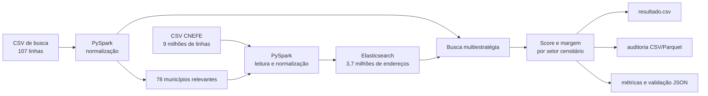

# CNEFE Address Linkage Pipeline

Pipeline reprodutível de engenharia de dados para localizar o setor censitário
de endereços da Bahia a partir do Cadastro Nacional de Endereços para Fins
Estatísticos (CNEFE). O projeto usa **PySpark** para processamento, **Elasticsearch**
para recuperação de candidatos e **Docker Compose** para executar o ambiente.

> O enunciado estima 100 consultas, mas o CSV recebido contém 107. A pipeline
> preserva todas as linhas reais do arquivo, sem truncar a entrada.

## Resultado da execução de referência

Execução completa realizada com os arquivos fornecidos:

| Indicador | Resultado |
|---|---:|
| Linhas do CNEFE Bahia | 9.047.296 |
| Municípios presentes nas consultas | 78 |
| Endereços únicos indexados | 3.756.323 |
| Consultas preservadas na saída | 107/107 |
| `ENCONTRADO` | 50 |
| `AMBIGUO` — revisão manual | 42 |
| `NAO_ENCONTRADO` | 15 |
| Validação estrutural | aprovada |
| Testes automatizados | 11 aprovados |

Esses números são **métricas descritivas**, não acurácia, precisão ou recall. O
conjunto entregue não possui um padrão-ouro com os setores corretos. Casos
ambíguos não recebem setor automaticamente para evitar falsos positivos.

## Arquitetura



O filtro por município acontece antes da indexação. Ele reduz tempo e espaço
sem eliminar candidatos válidos, pois toda consulta possui código municipal.
Para indexar toda a Bahia, use `--all-municipalities`.

## Estratégia de vinculação

### 1. Normalização

As colunas originais nunca são sobrescritas. São criados campos auxiliares com:

- texto em minúsculas, sem acentos, pontuação duplicada ou espaços excedentes;
- expansão conservadora de abreviações, como `AV` para `avenida`;
- padronização de `S/N`, `SN` e equivalentes para `sn`;
- números alfanuméricos preservados, por exemplo `102 E` para `102e`;
- CEP com exatamente oito dígitos;
- chave municipal comum de seis dígitos;
- CEP, município e setor sempre como texto, preservando zeros à esquerda e o
  sufixo `P` de alguns setores.

As regras e exemplos estão detalhados em `observacoes.md`.

### 2. Recuperação de candidatos

As consultas ao Elasticsearch combinam estratégias exatas e aproximadas:

1. logradouro, CEP e, quando disponível, número exatos;
2. CEP e número exatos, tolerando ruído no logradouro;
3. logradouro e número exatos;
4. logradouro e bairro/localidade exatos;
5. CEP exato com logradouro aproximado;
6. logradouro aproximado dentro do município.

Os candidatos das estratégias são reunidos e reordenados pela mesma regra,
evitando que o primeiro resultado do mecanismo de busca decida sozinho.

### 3. Score e decisão

O score vai de 0 a 100 e usa somente campos disponíveis:

| Evidência | Peso |
|---|---:|
| similaridade do logradouro | 45 |
| número igual | 25 |
| CEP igual | 20 |
| bairro/localidade similar | 7 |
| complemento similar | 3 |

Os candidatos são consolidados por setor. A decisão padrão é:

- `ENCONTRADO`: score mínimo 70 e diferença mínima de 2 pontos para o segundo
  setor;
- `AMBIGUO`: score mínimo atingido, mas sem margem suficiente;
- `NAO_ENCONTRADO`: nenhum candidato ou score abaixo de 70.

Os limites são configuráveis. O arquivo de auditoria permite revisar cada
candidato, seu endereço no CNEFE e as evidências do score.

## Estrutura do repositório

```text
.
├── compose.yaml                    # Elasticsearch e pipeline
├── Dockerfile                      # Python 3.11, Java 17 e dependências
├── requirements.txt                # PySpark e cliente Elasticsearch
├── elasticsearch/
│   └── index_cnefe.json            # analyzer, normalizer e mapping estrito
├── src/
│   ├── main.py                     # comandos index, match, all e validate
│   ├── settings.py                 # configuração por variáveis de ambiente
│   ├── spark_utils.py              # sessão Spark e leitura das bases
│   ├── profile_data.py             # perfil exploratório dos CSVs
│   ├── normalizacao.py             # transformações PySpark
│   ├── index_cnefe.py              # preparação e bulk indexing
│   ├── elasticsearch_service.py     # cliente e ciclo de vida do índice
│   ├── linkage.py                  # consultas, score, ranking e decisão
│   ├── match_addresses.py          # execução e escrita das entregas
│   ├── metrics.py                  # métricas descritivas
│   └── validate_output.py          # validação estrutural do resultado
├── tests/
│   ├── test_normalizacao.py
│   └── test_linkage.py
├── observacoes.md                  # catálogo das regras de normalização
└── RELATORIO_TECNICO.md            # relatório detalhado da implementação
```

As pastas `raw/` e `output/` são locais e ignoradas pelo Git.

## Pré-requisitos

- Docker Desktop em execução com backend Linux/WSL 2;
- pelo menos 4 GB de memória disponibilizados ao Docker;
- aproximadamente 10 GB livres para imagem, índice e arquivos temporários.

Não é necessário instalar Java, Spark, Python ou Elasticsearch no Windows para
executar pelo Docker.

## Preparação dos dados

Crie a pasta `raw` na raiz e coloque nela exatamente:

```text
raw/29_BA.csv
raw/2026_teste_tecnico_relinke_cidacs(in).csv
```

Os dados não são enviados ao GitHub por estarem listados no `.gitignore` e no
`.dockerignore`.

## Execução rápida

No PowerShell, dentro da raiz do projeto:

```powershell
docker compose up -d elasticsearch
docker compose build pipeline
docker compose run --rm pipeline all
```

O comando `all` recria o índice, processa o CNEFE, vincula as 107 consultas,
gera as entregas e valida a saída. Na execução de referência, o processo
completo levou cerca de nove minutos; o tempo depende do disco, CPU e memória.

### Executar por etapas

```powershell
# Indexa o CNEFE dos municípios usados pela busca
docker compose run --rm pipeline index

# Reutiliza o índice e gera os resultados
docker compose run --rm pipeline match

# Repete somente a validação do resultado.csv
docker compose run --rm pipeline validate
```

Para testar a infraestrutura rapidamente, sem produzir o resultado definitivo:

```powershell
docker compose run --rm pipeline index --limit 1000
```

O índice de amostra não cobre todas as consultas. Reexecute `index` sem
`--limit` antes de gerar a entrega final.

Para indexar todos os municípios baianos:

```powershell
docker compose run --rm pipeline index --all-municipalities
```

### Perfil exploratório

```powershell
docker compose run --rm --entrypoint python pipeline -m src.profile_data --dataset search
docker compose run --rm --entrypoint python pipeline -m src.profile_data --dataset cnefe
```

## Testes

```powershell
docker compose run --rm --entrypoint python pipeline `
  -m unittest discover -s tests -v
```

A suíte cobre normalização textual, número, CEP, município, integração das
transformações Spark, construção das estratégias, score, ranking e decisão.

## Arquivos gerados

| Arquivo | Conteúdo |
|---|---|
| `output/resultado.csv` | entrada original mais setor, status, método, score e margem |
| `output/auditoria.csv` | todos os candidatos e evidências legíveis |
| `output/auditoria.parquet/` | mesma auditoria em formato analítico |
| `output/metricas.json` | cobertura, ambiguidade, métodos e distribuição de scores |
| `output/validacao.json` | preservação de linhas/colunas e consistência dos status |
| `output/indexacao.json` | quantidade indexada e escopo municipal |
| `output/logs/pipeline.log` | log operacional persistente |

O CSV usa ponto e vírgula e UTF-8 com BOM para facilitar a abertura no Excel.

## Configuração

As principais variáveis podem ser alteradas em `compose.yaml`:

| Variável | Padrão | Finalidade |
|---|---:|---|
| `INDEX_RELEVANT_MUNICIPALITIES_ONLY` | `true` | indexa somente municípios consultados |
| `INDEX_BATCH_SIZE` | `1000` | tamanho do lote enviado ao Elasticsearch |
| `MATCH_CANDIDATE_SIZE` | `20` | candidatos por estratégia |
| `MATCH_MIN_SCORE` | `70` | score mínimo para aceitar um vínculo |
| `MATCH_MIN_MARGIN` | `2` | vantagem mínima sobre o segundo setor |
| `SPARK_DRIVER_MEMORY` | `2g` | heap do driver Spark |
| `SPARK_STREAM_PARTITIONS` | `128` | controla o tamanho das partições indexadas |
| `RECREATE_INDEX` | `true` | recria o índice no comando `index`/`all` |

## Segurança e publicação no GitHub

O `compose.yaml` desativa a segurança do Elasticsearch **somente para
desenvolvimento local** e publica a porta em `127.0.0.1`, não em todas as
interfaces. Esse Compose não deve ser implantado em servidor público.

Antes de publicar:

- confirme com `git status` que `raw/`, `output/`, `.env`, chaves e certificados
  não aparecem;
- nunca grave senha, API key ou certificado privado no YAML;
- em ambiente real, habilite TLS e autenticação e injete credenciais por Docker
  Secrets ou pelo gerenciador de segredos da plataforma;
- use `.env.example` apenas como referência, sem valores reais;
- ative secret scanning e proteção de branch no GitHub.

Referências oficiais: [Docker Compose](https://docs.docker.com/compose/),
[segurança do Elasticsearch](https://www.elastic.co/docs/deploy-manage/security/secure-your-cluster-deployment)
e [PySpark](https://spark.apache.org/docs/latest/api/python/).

## Limitações e próximos passos

- Sem padrão-ouro, os limiares não foram medidos por precisão/recall; foram
  calibrados para separar claramente resultados incertos.
- Bairro da consulta e localidade do CNEFE não são semanticamente equivalentes,
  por isso recebem peso baixo.
- Endereços rurais, descrições longas e logradouros genéricos continuam sendo
  os casos mais difíceis.
- Os 42 casos `AMBIGUO` devem ser revisados usando `auditoria.csv`; depois, uma
  pequena amostra rotulada pode calibrar pesos e limiares objetivamente.
- Para produção, recomenda-se transformar a revisão manual em tabela de
  decisões e medir precisão, recall e cobertura por faixa de score.

## Encerramento do ambiente

```powershell
# Para os containers, preservando o índice
docker compose stop

# Remove containers e rede; o volume do índice é preservado
docker compose down
```

Use `docker compose down -v` somente se quiser apagar também o índice local.
